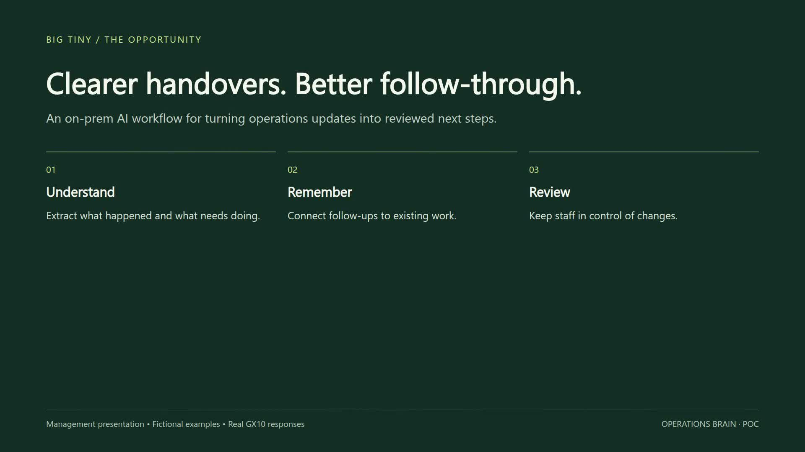
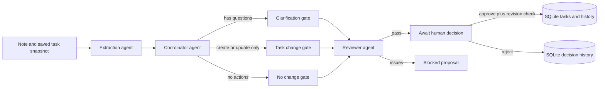

# Big Tiny Operations Brain

A local proof of concept for turning an internal maintenance or operations note into **proposed** task changes. It uses the actual GX10 on-prem model, remembers approved tasks in SQLite, and waits for a human decision before changing task memory.

The application uses established open-source components rather than a custom agent or web framework:

- **LangGraph 1.2.22** executes the agent workflow and conditional routing (MIT).
- **Streamlit 1.67.0** provides the dashboard, widgets, progress polling and task table (Apache 2.0).
- **SQLite** provides local persistence through Python's standard library (public domain).

One model supplies three role prompts; these are perspectives, not three independent models. The custom Python code is limited to the business prompts, validation, transaction rules and dashboard composition. No LangSmith account, cloud orchestration, SaaS database or paid API is required for the GX10 configuration. Source is inspectable and portable; dependency licenses remain their respective owners'.

## Architecture and direction workshop

We are exploring which internal operations workflow is worth piloting. The maintenance demo proves the basic flow; it is not a commitment to build a company-wide autonomous system.

| Read | What it helps decide |
| --- | --- |
| [Architecture diagrams](docs/architecture.md) | What exists today, how memory and approvals work, and what a future shared system would require |
| [Discovery and pilot proposal](docs/discovery-proposal.md) | Compare handovers, maintenance, SOP lookup, readiness, quotations and internal improvement research |
| [Brainstorming workshop](docs/brainstorm-workshop.md) | Run a 45-minute staff discussion, capture evidence and select one measurable experiment |

The pack focuses on **operations and property management**. It includes seven editable Mermaid diagrams, public-source research, clearly labelled assumptions, and proposed evaluation criteria. Future features remain discussion options. GitHub renders the diagrams directly in the Markdown pages.

## Narrated management presentation

[](https://github.com/caspar5911/Simple-Autonomous/raw/refs/heads/main/docs/executive-demo.mp4)

[Watch or download the presentation with female neural narration](https://github.com/caspar5911/Simple-Autonomous/raw/refs/heads/main/docs/executive-demo.mp4) · [Chapters and transcript](docs/executive-presentation.md) · [Optional subtitles](docs/executive-demo.srt)

A widescreen presentation for management: the operational problem, proposed value, open-source architecture, a fresh real-GX10 walkthrough, current limits, and a focused pilot decision request. Productivity targets are explicitly presented as proposed evaluation criteria, not proven results. The walkthrough uses fictional records; the narration is a synthetic Singapore English female voice.

## End-to-end video

[Watch or download the 91-second demo (MP4, 2.6 MB)](https://github.com/caspar5911/Simple-Autonomous/raw/refs/heads/main/docs/end-to-end-demo.mp4)

A captioned screen recording of the actual Streamlit app using the on-prem GX10 model through Tailscale. It demonstrates:

1. Submit a fictional maintenance note and watch the three agent roles.
2. Review and approve a new task.
3. Submit a follow-up and approve an update to the same saved task.
4. Submit an ambiguous request and acknowledge a clarification without completing the task.

Recorded on 2026-11-16 with a separate temporary database and nine real model calls. Captions explain the flow; there is no audio. The final database was checked to contain one unfinished task with the revised date and three approval records. No real business data appears in the recording. If GitHub does not play the file inline, download it and open it in a video player.

## Quick start: Linux or WSL

Prerequisites: Python **3.14** (the tested version), `venv`, package download access for installation, and tailnet access to GX10. Other Python versions have not been verified against the frozen dependency set.

```bash
git clone https://github.com/caspar5911/Simple-Autonomous.git
cd Simple-Autonomous
python3 -m venv .venv
.venv/bin/python -m pip install -r requirements.lock
bash start.sh
```

Open **http://127.0.0.1:8780**. Stop with `Ctrl+C`. A different free port can be selected with `BRAIN_PORT=8781 bash start.sh`. Run one application process per SQLite file. The tested local working copy is `/home/casparlzk/big-tiny-brain`.

The default model connection is:

```text
https://gx10-ai.tail5c8e5b.ts.net/v1
served model: gx10-current
```

Check connectivity without changing anything on GX10:

```bash
curl https://gx10-ai.tail5c8e5b.ts.net/v1/models
```

The application never installs, starts, stops, switches or reconfigures a GX10 model or service.

## Windows PowerShell

Install Python 3.14, clone the repository into a local directory, then:

```powershell
cd Simple-Autonomous
py -3.14 -m venv .venv
.\.venv\Scripts\python.exe -m pip install -r requirements.lock
.\.venv\Scripts\python.exe -m streamlit run app.py --server.address=127.0.0.1 --server.port=8780
```

Open http://127.0.0.1:8780. Native Windows dependency installation is documented but has not been run here; the verified installation is Python 3.14 in Ubuntu 26.04 WSL. Windows can also run the verified WSL version:

```powershell
wsl -d Ubuntu-26.04 -- bash -lc 'cd /home/casparlzk/big-tiny-brain && bash start.sh'
```

## Try the complete workflow

The example menu contains only fictional training notes. An empty database is intentional: there are no fabricated tasks or automatic demo results.

1. Choose **New maintenance task**, click **Use selected example**, then **Send to your agents**. The note describes Maya arranging a plumber for the Cedar Grove kitchen tap by 2026-11-23.
2. Watch extraction, coordination and review finish. Inspect the quoted evidence and proposed fields. **No task exists yet.** Click **Approve proposal** to save the task.
3. Choose **Follow-up to saved task**, load it and submit. The coordinator receives saved memory, matches the same task, and proposes the booked visit on 2026-11-24 with an in-progress status. Compare the current task with the proposal before approving. There should still be one task.
4. Choose **Ambiguous request** and submit. The note cannot identify the job to mark done. Expect a clarification question rather than a guessed completion. **Acknowledge questions** records your decision without creating or modifying a task. Add the answer and relevant context to a new note to continue.
5. Inspect **Task memory** and **Decision history**. Restart the app to verify persistence. You can reject a proposal at any time after review; rejection never applies proposed task changes.

Dates in examples are fixed fictional dates, not a live operational schedule. Model output is probabilistic: if the reviewer blocks or validation rejects a proposal, inspect the visible issue and rerun with clearer context. The app never silently substitutes a canned answer.

## What the graph actually does



`brain.py` constructs and invokes a real `StateGraph`. Conditional edges choose a clarification, task-change or no-change gate and then route the reviewer decision to awaiting-human or blocked. Mixed proposals retain every action; any clarification sends the proposal through the clarification gate. The dashboard displays the action kinds. Task changes are never executed inside the graph: an explicit human decision applies them in a separate SQLite transaction.

The model receives the original note, validated extraction and saved task snapshot. Extraction and proposed actions must contain exact nonempty quotes from the note. Outputs must match strict JSON field sets, types, action kinds, task IDs, statuses and ISO dates. The reviewer checks meaning, duplication and unsupported changes. This supports review; it does not prove model judgments are correct.

Approvals compare the proposal's saved revision with the current revision inside `BEGIN IMMEDIATE`. If another approval changed memory, the stale proposal is rejected and must be rerun. Approving the same run twice is prohibited. All proposed changes, the task updates, revision and history entry commit atomically. A clarification-only or no-change approval also advances the revision conservatively. Rejections do not advance it.

## Configuration

Set environment variables before starting. Credentials belong in the process environment, never in tracked files.

| Variable | Default | Purpose |
| --- | --- | --- |
| `BRAIN_MODEL_URL` | `https://gx10-ai.tail5c8e5b.ts.net/v1` | OpenAI-compatible base URL; include `/v1` |
| `BRAIN_MODEL` | `gx10-current` | Served model name |
| `BRAIN_API_KEY` | unset | Optional Bearer token for a compatible provider |
| `BRAIN_REASONING_EFFORT` | `low` | Request reasoning level; set to empty string to omit the parameter |
| `BRAIN_TIMEZONE` | `Asia/Singapore` | IANA timezone used for the model's current date |
| `BRAIN_DB` | `data/brain.sqlite3` | SQLite file; set an absolute path for another location |
| `BRAIN_PORT` | `8780` | Port used by `start.sh`; native Windows uses the CLI flag |

Example A9 compatibility tunnel (only if that tunnel is already available on the same machine):

```bash
export BRAIN_MODEL_URL=http://127.0.0.1:8888/v1
bash start.sh
```

Example compatible provider with no `reasoning_effort` support:

```bash
export BRAIN_MODEL_URL=https://your-provider.example/v1
export BRAIN_MODEL=your-served-name
export BRAIN_REASONING_EFFORT=''
# Supply BRAIN_API_KEY securely in your environment if required.
bash start.sh
```

Provider support means the **OpenAI-compatible `/chat/completions` protocol** with text JSON responses and `finish_reason=stop`. It does not imply compatibility with Anthropic's native Claude Messages API. Providers may need different parameters or stronger JSON support. Switching to an external provider sends notes and task snapshots there; the default GX10 configuration sends them only to the on-prem endpoint.

## Local data and bounds

- Streamlit binds to **127.0.0.1**. Do not expose this POC as a shared or public service: it has no user accounts or authorization model.
- SQLite stores submitted raw notes, stages, validated agent outputs, errors, tasks and decision history on disk. **Submitted notes are persisted before approval**; only task changes wait for approval. The database is plaintext and excluded from Git and Docker build context. Copy `data/brain.sqlite3` while the app is stopped to move or back up memory. Keep internal data access limited at the filesystem level.
- Streamlit usage statistics and LangSmith tracing are disabled. Model-derived content is rendered as text rather than executable HTML or Markdown images. No messages, emails, tickets or external tools are sent or invoked.
- Each note triggers at most **three sequential model calls**, one per role. Each call has a **120-second response timeout**, a **3,500-token output budget**, and no retries. Invalid, empty, truncated or reasoning-only answers fail visibly without changing tasks.
- Notes are limited to **12,000 characters**, extractions/proposals to **12 items/actions**, and memory to **200 tasks**. Only one run executes at a time per process; submission is disabled or rejected until that run finishes. There is no queue. The UI shows the latest 30 runs and 50 decisions; older records remain in SQLite.
- On restart, unfinished runs become failed with an explicit restart message. There is no automatic recovery/replay, recurring scheduler, arbitrary tool execution, long-term semantic search, multi-user collaboration or unattended autonomous execution.

## Tests

Deterministic tests use temporary databases and explicit mocked model responses; the running app never uses those mocks:

```bash
.venv/bin/python -m unittest -v test_brain
```

Tests cover actual graph execution, create/update/clarify, human approval, rejection, reviewer blocking, stale and repeated approval, SQLite persistence, invalid IDs/dates/evidence, and Streamlit rendering, sample selection and approval interaction.

An opt-in integration test calls the **real configured model nine times** with the three fictional notes above, approves only its temporary test proposals, and removes its isolated database afterward:

```bash
.venv/bin/python smoke_model.py
```

Verified on 2026-11-16 with Python 3.14.4 / Ubuntu 26.04 WSL: 9 deterministic tests passed; the real GX10 create → approved memory → same-task update → clarification sequence passed all nine role calls. No serving configuration was changed. Docker and native Windows startup have not been executed.

## Docker (Linux host networking)

The supplied image retains loopback binding; use Linux host networking so it can reach an existing host A9 tunnel if configured:

```bash
docker build -t big-tiny-brain .
docker run --rm --network host \
  -v big-tiny-brain-data:/data \
  big-tiny-brain
```

Open http://127.0.0.1:8780 on that Linux host. Docker Desktop host networking is not assumed; use native Python/WSL there. Dependencies install during image build; runtime needs only access to the configured model. The Docker path is provided for portability and has not been verified here.

## Troubleshooting

**Port is unavailable:** select a free port, e.g. `BRAIN_PORT=8781 bash start.sh`. Do not stop unrelated services or existing SSH tunnels.

**Model unavailable / HTTP error:** check tailnet connectivity and `/v1/models`, base URL and optional credentials. This app does not start a model or repair tunnels. A provider rejecting `reasoning_effort` needs `BRAIN_REASONING_EFFORT=''`.

**Invalid JSON, empty content or truncated answer:** inspect the failed run. The app deliberately refuses to guess or use a fallback. Shorten the note or use a model/provider that reliably returns the requested schema.

**Reviewer blocked:** inspect its issues, reject the proposal if appropriate, and submit a more specific note. You cannot override a failed review from the dashboard.

**Memory changed after proposal:** another proposal was approved against that task snapshot. Resubmit the original note to coordinate against current memory; stale approvals cannot overwrite newer tasks.

**Timezone unavailable:** install the locked dependencies (including timezone data) or set `BRAIN_TIMEZONE=UTC`.

**Interrupted run / app restart:** the historical run shows an explicit failure. Resubmit the note. Run only one Streamlit server per database; background threads and in-process locking are intentionally simple POC controls.

## Files

| File | Responsibility |
| --- | --- |
| `app.py` | Streamlit dashboard and human decisions |
| `brain.py` | LangGraph roles/routes, GX10 adapter, validation, SQLite transactions |
| `.streamlit/config.toml` | Loopback binding, theme and telemetry setting |
| `requirements.txt` / `requirements.lock` | Direct pinned packages / complete tested dependency set |
| `test_brain.py` | Deterministic storage, graph and dashboard tests |
| `smoke_model.py` | Opt-in real model end-to-end integration test |
| `start.sh` / `Dockerfile` | Local launcher / optional container |

Framework documentation: [LangGraph graph API](https://docs.langchain.com/oss/python/langgraph/graph-api), [Streamlit fragments](https://docs.streamlit.io/develop/api-reference/execution-flow/st.fragment), [Streamlit configuration](https://docs.streamlit.io/develop/api-reference/configuration/config.toml).
