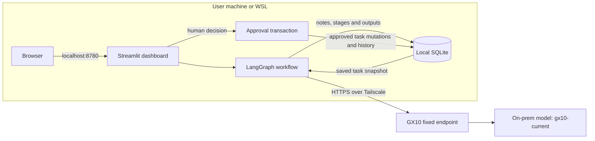
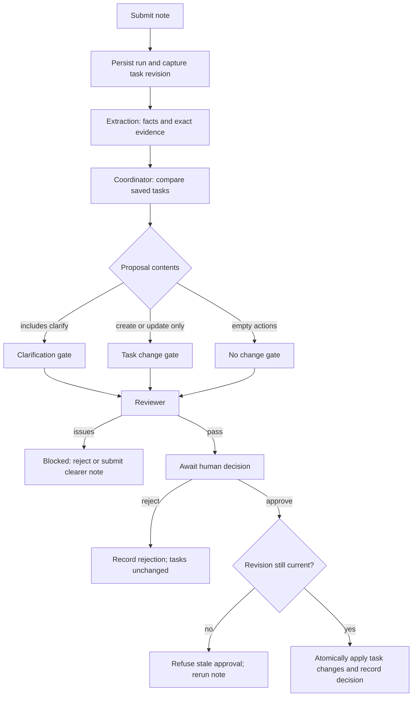
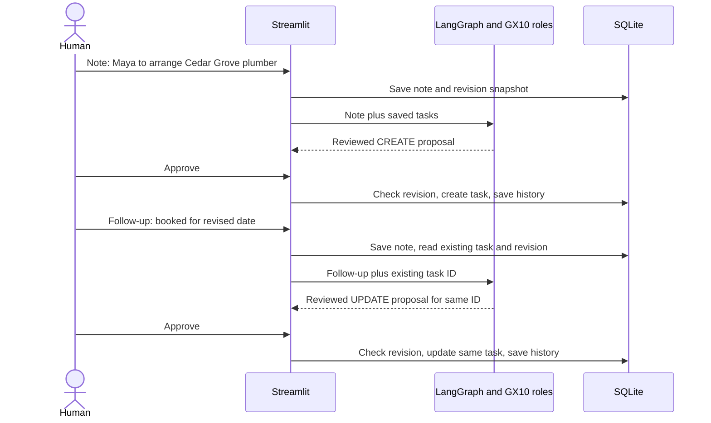
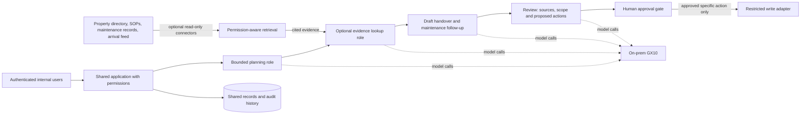

# Architecture: what exists and what could come next

This document separates the implemented proof of concept from possible next steps. The current design is verified against [app.py](../app.py), [brain.py](../brain.py) and the [README](../README.md). The future design is a discussion proposal, not an approved implementation plan.

## Current deployment

The browser connects to a local Streamlit application. Python runs the LangGraph workflow and stores its records in a local SQLite file. The three agent roles call the same on-prem model through the existing Tailscale endpoint; they are different prompts, not independent model servers.

The fixed API base is `https://gx10-ai.tail5c8e5b.ts.net/v1`. An already available A9 tunnel can alternatively use `http://127.0.0.1:8888/v1`. The app does not change model-serving services. There is no automatic cloud fallback.

**Approval governs task changes, not initial storage.** Submission immediately saves the raw note and run record. Agent stages, validated outputs and failures are saved as processing continues. A human decision is needed to change the task table; approvals and rejections also create history records. SQLite is plaintext local storage.

## Current runtime

Schema and evidence validation runs between roles. Invalid JSON, unsupported IDs, invalid dates or unquoted evidence fails the run without task changes. Model judgments still need human review: valid structure and quoted evidence do not establish that a proposed interpretation is correct.

A proposal may contain several action kinds. Any clarification chooses the clarification gate while retaining other proposed actions. A clarification-only approval records the question without creating a task. Answers are supplied in a new note; there is no autonomous clarification conversation.

There are at most three sequential model calls per submission, with no retries. Only one run executes per process. The dashboard polls persisted progress every two seconds. Restarted in-flight runs become failed rather than resuming automatically.

## How saved memory changes the next run

The fictional maintenance example demonstrates coordination across submissions rather than a stateless response:

Approval uses a SQLite transaction and revision comparison. A newer approval invalidates older proposals, preventing stale updates from overwriting current memory. Repeated approval is rejected. Even clarification-only approvals conservatively advance the revision.

## Current boundaries

Cloning the repository copies code, not the ignored database. Each clone normally starts with separate memory; it does not join a shared company brain. Moving memory requires an explicit database transfer while the app is stopped. Run one application process per database.

There are no accounts, shared permissions, source connectors, document retrieval, web research, messaging integrations, scheduled jobs or external write tools. Context consists of the submitted note and saved tasks, not the entire company's knowledge. Limits include 12,000 note characters, 12 actions and 200 saved tasks. The POC is intended for loopback access, not shared deployment.

## Proposed future architecture — subject to a direction decision

If a shared workspace proves useful, authentication, source permissions, durable job handling and reliable backups become prerequisites. The storage choice should follow actual concurrency and recovery needs; no enterprise stack is selected here.

For operations and property management, a candidate first pilot is **daily handover and maintenance follow-up**, subject to staff interviews. It could identify unresolved jobs, clarify responsibility and draft the next shift's handover. Arrival readiness should be assessed only when reliable arrival and maintenance records are available; a model cannot verify physical readiness itself.

Optional read-only connectors could supply a property directory, SOPs, maintenance records or an arrival feed. Their availability and access are unconfirmed. Retrieval should preserve source identity, permissions and freshness. Readiness claims and recommendations need citations to supporting records, with uncertainty visible when evidence conflicts or is missing. SOP lookup and vendor comparison are possible later workflows, not committed features. External research would need a separately agreed scope.

Planning, evidence lookup, drafting and review are candidate roles, not a requirement to add agents. Add a role only when the chosen workflow benefits from it. Bound model calls, tool permissions and completion criteria. Keep human approval before any external write or send, and bind it to the exact proposed action. Continue using the on-prem endpoint unless a provider change is explicitly chosen; failures should remain visible rather than triggering a cloud fallback.
