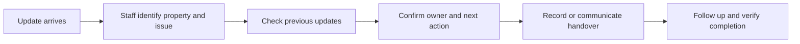

# Brainstorming workshop: property operations

Working worksheet for the [discovery proposal](discovery-proposal.md). Status: **unfilled**. All examples below are prompts, not claims about Big Tiny's internal processes. Keep confidential staff examples and customer data out of this public repository.

## Suggested 45-minute session

Invite an operations lead, a staff member who handles daily updates, and a property-management representative. One person records decisions. Include the owner of the relevant data/system when discussing access.

| Time | Discussion | Capture |
| --- | --- | --- |
| 0–10 min | Walk through one recent handover or maintenance follow-up | Actual steps, tools, people and waiting points |
| 10–20 min | Find repeated preparation, searching and chasing | Frequency, active minutes, consequences, real examples |
| 20–30 min | Compare two or three candidate improvements | Inputs available, proposed output, human reviewer |
| 30–40 min | Choose one small experiment | Baseline, quality checks, stop conditions |
| 40–45 min | Assign owners and next decisions | Named owner, next meeting and evidence to bring |

## Map one real case

Start with: “Show us the last time this happened.” Avoid starting with how many agents the team wants.

This is an example process to correct with staff. At each step ask: what is copied, what is looked up, where is time spent, and what causes rework?

| Field | Staff answer |
| --- | --- |
| Trigger and expected outcome | To confirm |
| Person doing the work | To confirm |
| Authoritative task record | To confirm |
| Message/document inputs | To confirm |
| Property and issue identifiers | To confirm |
| Normal case and difficult case | To confirm |
| Active work minutes and waiting time | To measure separately |
| Cases per day/week | To measure |
| Cost of a wrong answer or missed action | Describe before choosing automation |
| Final reviewer and closure authority | To confirm |

## Prompts for brainstorming

- **Handover:** Which updates must the next shift know, and which are noise? What does a good handover look like?
- **Maintenance:** How do you tell a new incident from another update on the same one? What evidence is required before closing it?
- **Readiness:** Which facts are needed before a property can be called ready? Who can confirm each fact, and when does it expire?
- **SOPs:** Which questions are repeatedly answered by the same experienced staff? Are the answers written down and current?
- **Purchasing:** What makes two repair quotes genuinely comparable? Which exclusions are commonly overlooked?
- **Reporting:** Which management questions require manual consolidation? Would a regular database report solve them without AI?
- **Improvement research:** Which recurring problem merits a small experiment? What evidence would distinguish its possible causes?

## Compare candidates without invented scores

Fill this from observation. Do not treat an empty cell as zero or let a demo's visual appeal decide priority.

| Candidate | Frequency | Current staff time | Review time expected | Data accessible? | Error consequence | Responsible owner | Decision |
| --- | --- | --- | --- | --- | --- | --- | --- |
| Handover + maintenance follow-up | Unknown | Unknown | To measure | To confirm | To discuss | Unassigned | Candidate |
| Sourced SOP lookup | Unknown | Unknown | To measure | To confirm | To discuss | Unassigned | Candidate |
| Property-readiness exceptions | Unknown | Unknown | To measure | To confirm | To discuss | Unassigned | Candidate |
| Staff-proposed alternative | Unknown | Unknown | To measure | To confirm | To discuss | Unassigned | Candidate |

Prefer a recurring problem with obtainable evidence, an observable output, a reviewer and reversible consequences. If none fits, improve the process or data first.

## One-page experiment charter

Copy this section for the chosen workflow:

- **Problem:** [specific recurring work and who experiences it]
- **Hypothesis:** [why the proposed assistance would reduce work]
- **Scope:** [one team, property group and case type]
- **Owner and reviewer:** [names/roles held in an appropriate private record]
- **Inputs and access:** [approved sources, identifiers, freshness and permissions]
- **Output:** [exact draft or proposed change staff will review]
- **Baseline:** [manual process plus any simpler alternative]
- **Evaluation examples:** [representative cases, including ambiguity and contradictions]
- **Success measures:** [net staff time, quality, traceability and review burden]
- **Stop conditions:** [critical error, no time saved, unreliable inputs]
- **Source of truth:** [existing system; how duplicate recordkeeping is avoided]
- **What is excluded:** [messages, bookings, spending or other unsupported actions]
- **Decision date:** [set after access and participation are confirmed]

## Evidence and decision log

| Date | Question | Evidence or assumption | Decision | Owner | Revisit when |
| --- | --- | --- | --- | --- | --- |
| 2026-11-16 | Which team should discovery focus on? | User selected operations and property management | Focus this discovery pack on that team | Pilot owner not yet assigned | User changes scope |
| 2026-11-16 | Which workflow should be piloted? | Existing POC fits task handovers; no staff baseline yet | Recommend evaluating handover/follow-up first; not approved | Unassigned | Interviews and examples are available |

Keep research results, assumptions and decisions distinct. A plausible suggestion becomes a pilot commitment only when an owner, evidence, scope and success test are agreed.
