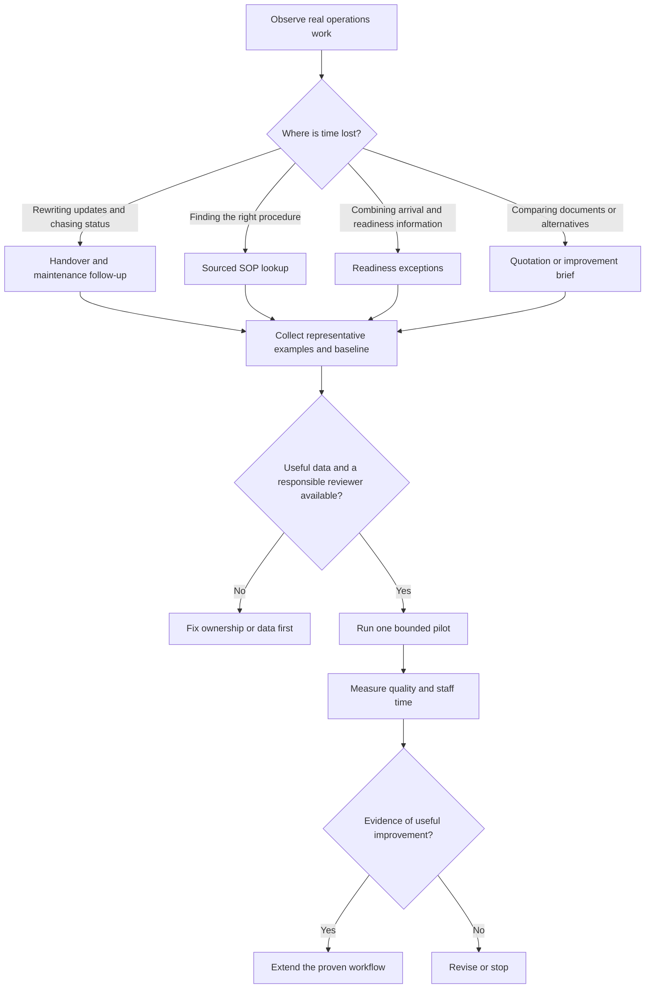

# Big Tiny: operations discovery and pilot proposal

Status: **discussion draft, not an approved roadmap**. Prepared 2026-11-16. Audience: operations and property management. The existing POC demonstrates a mechanism; the next step is to discover which recurring work is worth improving.

Read alongside [architecture diagrams](architecture.md), the [brainstorming workshop](brainstorm-workshop.md), and the [recorded POC](end-to-end-demo.mp4).

## Decision to make

Which one operational workflow should Big Tiny pilot, with which staff, information and measurable outcome?

**Provisional recommendation:** test a daily operations handover with maintenance follow-ups. Staff submit updates; the system proposes a consolidated action list, connects follow-ups to existing issues, and flags unresolved questions. A person checks every proposed change. Choose a different starting point if interviews show that finding procedures or checking property readiness consumes more time.

The aim is less administrative work and fewer missed follow-ups. Adding agents is an implementation choice, not the success measure.

## What we know and what we do not

| Evidence | Implication for exploration | Limit |
| --- | --- | --- |
| Big Tiny's public website connects its business to modular accommodation, hospitality and operational services. [Company site](https://www.bigtiny.com.sg/) | Property operations are a relevant area to investigate. | Public marketing does not tell us how internal work is actually organised. |
| Its contact/about page discusses property-management partners and lists offices and production facilities in several locations. [Company page](https://www.bigtiny.com.sg/aboutbigtiny) | Handoffs between locations and partners are a plausible productivity opportunity. | Missed handoffs, their frequency and cost remain hypotheses. |
| The user selected operations and property management for this proposal. | Prioritise staff coordination and property information. | A pilot owner and specific team have not been named. |
| The implemented POC passed create, approval, same-task update and clarification using GX10. [Implementation and tests](../README.md#tests) | The basic model-to-workflow connection works on fictional examples. | It has not demonstrated staff time savings, operational accuracy or production readiness. |

We do not yet know the actual booking/property system, messaging channels, task tracker, property identifiers, SOP quality, data permissions, volumes, languages, budgets or service expectations. References to those systems below describe possible inputs, not connected services. The Tiny Away host page was not readable in this research session, so it supplies no evidence here. No internal company documents were reviewed.

## Candidate directions

The effort labels are relative planning judgments based on the current code, not delivery estimates. Benefits are hypotheses to validate.

| Direction | Realistic staff question or input | Useful output | Information needed | Relative extension | Test of value |
| --- | --- | --- | --- | --- | --- |
| **Daily handover and maintenance follow-up** | “What is still open at these properties? Here are today's updates.” | Proposed task updates, unresolved questions and a draft handover | Staff notes, current task register, property aliases | Smaller: current POC plus summary and reliable identifiers | Less preparation/review time; fewer omitted actions |
| **SOP and property-information lookup** | “What is the approved procedure for this water-system fault?” | Answer with document, section and revision, or an explicit gap | Approved SOPs, property applicability, document owner | Moderate: ingestion, access filters and retrieval | Correct sourced answers; less time searching |
| **Property-readiness check** | “Which properties need attention before tomorrow's arrivals?” | Exceptions with data timestamps and named evidence gaps | Authorised arrival feed, cleaning/maintenance status, readiness rules | Larger: trustworthy joins and freshness checks | Staff find readiness blockers earlier; no unsupported all-clear |
| **Vendor quotation comparison** | “Compare these three quotes for the same repair.” | Side-by-side scope, exclusions, dates and questions for suppliers | Submitted quotes, required scope, internal purchasing rules | Moderate: document extraction and normalised comparison | Faster comparison without lost exclusions |
| **Weekly operations report** | “What changed this week, and what needs a manager's decision?” | Draft exceptions report linked to tasks and decisions | Complete task history, reporting definitions | Smaller only after reliable task capture exists | Less report preparation; every claim traceable |
| **Repeat-issue research** | “Are similar faults recurring, and what should we investigate?” | Patterns in records, competing explanations and proposed checks | Sufficient consistent history, property/equipment IDs | Larger: data quality and analytical evaluation | Useful leads confirmed by staff; no invented root cause |
| **Operational improvement proposal** | “How could we reduce repeated linen shortages?” | Options, evidence, assumptions, experiment and decision brief | Relevant stock/incident records, staff observations, constraints | Moderate/larger depending on evidence access | Manager can compare options and approve a small experiment |

These are candidate products, not agents to implement simultaneously. A checklist or normal report may outperform an AI solution when rules and inputs are already structured.

## Visual decision map

## Recommended pilot: daily operations handover

**Hypothesis:** consolidating updates and matching follow-ups consumes enough staff time that a reviewed draft will save effort without introducing incorrect assignments or closures.

**Participants, proposed:** one operations lead and two or three staff handling a small representative property group. These are suggested pilot sizes, not known staffing levels. Name the accountable owner before collecting internal data.

**Inputs:** an approved, de-identified set of approximately 20 real examples, including new issues, repeated reports, changed dates, contradictory updates, unclear property names and confirmed completion. Use a property ID and a known staff directory where available. Do not assume a name in a message identifies an authorised assignee.

**Outputs:** proposed creates/updates/questions, exact supporting evidence, owner/date gaps, and a draft shift handover for staff review. The task proposal is implemented today. Batch handover generation, explicit property identity and staff-directory checks would be pilot additions.

**Working agreement:** the existing operational register remains authoritative during evaluation. Avoid maintaining two competing production task systems. Start with controlled copies and compare results; integration comes only after selecting a source of truth.

**Out of scope:** booking changes, vendor dispatch, spending, automatic messages, automatic work completion, emergency-response decisions, and company-wide rollout. Urgent incidents continue through existing escalation procedures. The POC is not an incident monitoring service.

### Example to discuss with staff

| Moment | Current POC can demonstrate | Additional capability to consider |
| --- | --- | --- |
| Staff report a leaking tap at a named cabin | Extract and propose a task | Match an approved property ID rather than rely only on text |
| Another staff member says a plumber is booked | Propose an update to the same saved task | Show the actual field-by-field changes |
| A message says “all fixed” with no property | Ask which issue is meant | Let staff attach the answer to a specific case |
| Shift lead asks for tomorrow's handover | Show saved tasks | Produce a concise handover with evidence and explicit missing information |
| A guest arrival makes the issue time-sensitive | Use an arrival date explicitly present in a note | Verify against an authorised, fresh booking feed; this is not implemented |

## Success measures and stop rules

The following are proposed pilot gates for agreement, not achieved results or guarantees. Have a staff reviewer label expected outcomes independently before comparing model output.

| Measure | How to measure | Proposed initial gate |
| --- | --- | --- |
| Net staff preparation time | Time manual work versus AI submission, waiting that blocks work, checking and corrections on comparable cases | At least 25% lower median active staff time; report total elapsed time separately |
| Action capture | Correct explicit actions found divided by all labelled explicit actions | At least 90% on the evaluation set |
| Task matching | Correct matched updates divided by all labelled follow-up updates | At least 95%; include ambiguous cases |
| Unsupported changes | Count invented owners/dates, wrong-property updates and unconfirmed completion proposals | Zero such critical errors accepted; investigate each critical proposal even if review caught it |
| Review burden | Record accepted unchanged, corrected/resubmitted and rejected cases | Fewer than 20% require substantial rework |
| Traceability | Check every proposed change has applicable source evidence | 100% of accepted changes traceable |

Twenty cases are enough to find obvious failures, not to establish a production error rate. Report counts alongside percentages and expand the sample before broader use. If net time is not saved, data cannot be matched reliably, or staff cannot review safely, stop expansion and address the cause.

A simple planning calculation is **weekly hours released = cases per week × net minutes saved per case / 60**. For illustration only, 100 cases saving 3 net minutes would release 5 hours per week. Actual volumes and times are unknown. Released time is not automatically cash savings; include review effort, hosting, support and integration work when assessing value.

## Proposed discovery-to-pilot sequence

| Stage | Activity | Deliverable | Decision |
| --- | --- | --- | --- |
| Discover | Interview lead and staff; observe one handover; collect approved examples | Current process map and evidence of friction | Is the problem frequent and worth addressing? |
| Define | Choose one workflow, owner, source of truth and quality thresholds | One-page pilot charter | Is the scope and data access acceptable? |
| Compare | Run current POC on labelled examples; compare against manual and single-call baselines | Error log, timing results and review notes | Does orchestration improve enough to justify its extra calls? |
| Pilot | Make only the smallest needed additions; staff review results on a limited property group | Pilot report with real counts | Extend, revise or stop? |
| Integrate | If useful, add one read-only source first; later consider approved write-back | Integration design and access checks | Is each new capability justified by measured benefit? |

Do not set a delivery date until data access and the selected workflow are understood. More model calls can add latency and repeat the same mistake: three roles on one model are not independent expert opinions.

## How research, brainstorming and proposals could fit later

There are two separate activities: **we are researching which product to build now**, and **the future product might help staff research an operational improvement**. The current app supports neither document search nor web browsing.

A future request such as “reduce repeat linen shortages” would need an evidence-first path:

Every brief should distinguish facts, hypotheses, options, costs still to obtain and decisions needed. The system should cite the record or document revision behind each substantive claim. External research, if approved later, needs a separate search capability; internal confidential context should not become a public search query. Model memory alone is not a research source.

## Open-source direction

Keep the current LangGraph, Streamlit and SQLite stack while evaluating the problem. LangGraph supports both predefined workflows and more dynamic agents; select the least complex path that produces a useful result. [Official workflow guidance](https://docs.langchain.com/oss/python/langgraph/workflows-agents)

If repeated searches across approved documents become necessary, evaluate retrieval then; first check whether a small structured property/SOP directory is sufficient. If jobs must survive restarts, evaluate persistent LangGraph checkpoints. The current app saves business records in SQLite but does not resume an interrupted graph. [Official persistence guidance](https://docs.langchain.com/oss/python/langgraph/persistence)

A shared team deployment would additionally need authentication, per-user access controls, a shared source of truth and tested recovery. Those are separate from having access to the model through Tailscale. Do not deploy the current unauthenticated local dashboard as a company portal.

## Decisions still open

- Which staff member owns the pilot and reviews results?
- Which properties and incident types are representative?
- Which system owns tasks, owners and closure status today?
- Are updates mostly chat messages, email, spreadsheets or an operations system?
- What identifiers can reliably join property, issue and equipment records?
- What are the actual daily volumes and minutes spent on preparation and chasing?
- Which examples and SOPs can be used, by whom, and where may they be stored?
- What result would make the team stop using the assistant?

Record answers and decisions in the [workshop worksheet](brainstorm-workshop.md). No workflow beyond the current POC is approved merely by appearing in this proposal.
